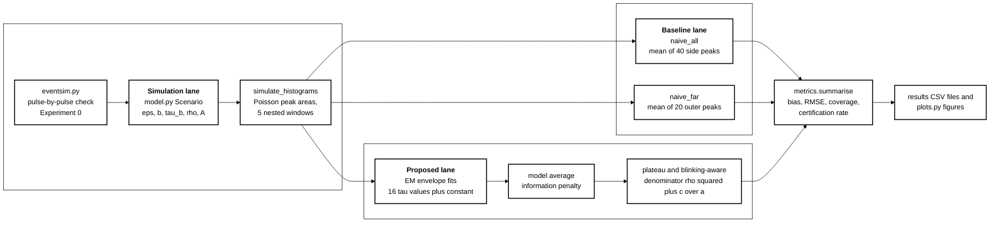
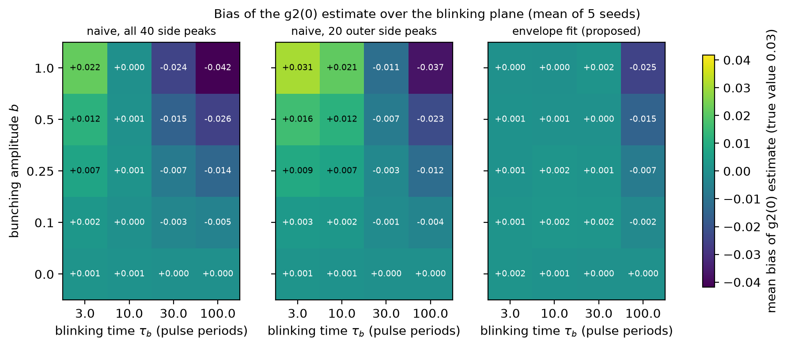
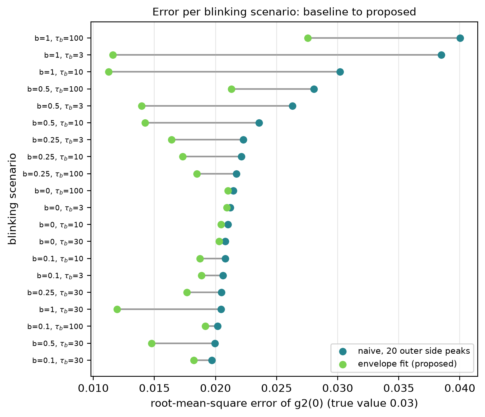
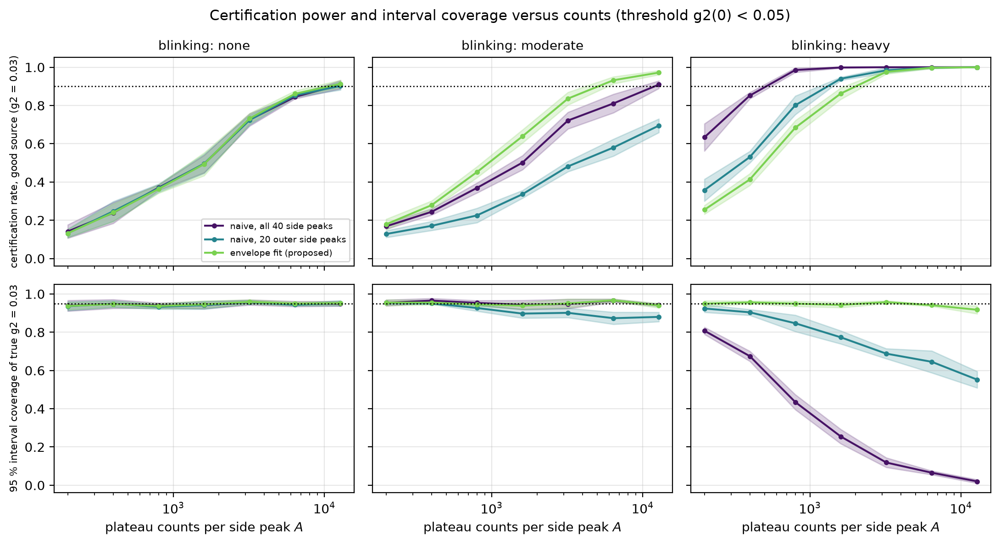
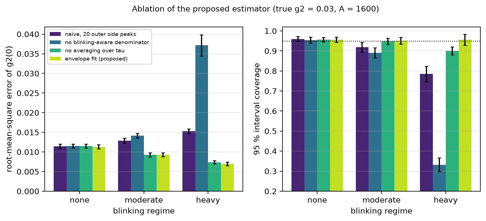
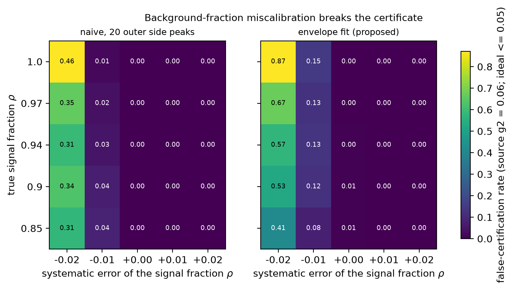
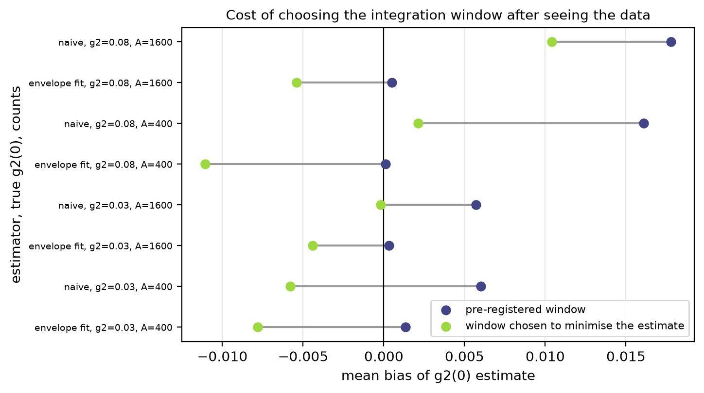

# Blinking-Aware Certification of g2(0) for Pulsed Single-Photon Sources


*(MIT: Massachusetts Institute of Technology licence; CI: continuous integration.)*

## Abstract
Pulsed single-photon sources such as quantum dots (QDs) are certified by the second-order intensity correlation at zero delay,
g2(0), read from a Hanbury Brown-Twiss (HBT) coincidence histogram as the ratio of the central-peak area to the side-peak plateau.
When the emitter blinks, the side peaks carry a slow bunching envelope and this ratio is biased, in either direction depending on
the blinking time scale. This simulation study compares two flat-plateau baselines with an envelope-fitting estimator that divides
by the fitted plateau with a blinking-aware denominator: in the nine strongly blinking cells tested the proposed estimator has a median absolute
bias of 0.064 times that of the stronger baseline, with 95% interval coverage between 0.937 and 0.960; it
also fails in a clearly identified regime (blinking slower than the record) and does not make the certificate robust to background miscalibration.

## Motivation
Quantitative characterisation of single-photon sources (purity, brightness, indistinguishability) turns raw photon-counting data into a
few numbers that are compared across devices. Each of those numbers is a ratio whose normalisation is itself measured, and a certificate
such as "g2(0) < 0.05" is only as good as that normalisation and the choices made while analysing. This report isolates the
normalisation, the analysis-window choice and the background-fraction calibration, and measures how each moves the certificate.

## Research gap
The literature brief for this project holds four recent papers only (no landmark, review or adjacent papers), so the related-work table in
[`docs/RESEARCH_GAP.md`](docs/RESEARCH_GAP.md) is correspondingly short. Three observations from it motivate the study:
(i) Ma et al., 2027 (digital object identifier, DOI: 10.1016/j.watres.2026.127204) show that normalised outputs lose physical scale and must be re-anchored, which is the situation
of an HBT histogram normalised by a plateau; (ii) Peng et al., 2027 (doi:10.1016/j.optcom.2026.133879) fix the estimation set before outcomes are
disclosed and state their bounds conditionally on calibration, a discipline that has no counterpart in g2(0) certification; (iii)
Srivastava et al., 2027 (doi:10.1016/j.optcom.2026.133855) note that validation beyond simulated conditions remains an open priority, and Huang and Qiu, 2027
(doi:10.1016/j.jcp.2026.115518) assess counting-type estimators in simulation only. None of them treats the normalisation of photon-correlation histograms.

## What is new here
* A blinking-aware estimator of g2(0): maximum-likelihood fit of a bunching envelope, model averaging over its time constant, and a denominator that accounts for the envelope at zero delay.
* A direct measurement of what pre-committing the integration window is worth, and of how a background-fraction calibration error propagates into false certification.
* A reproducible, validated simulator (peak-area model checked against a pulse-by-pulse simulation) with one-command experiments.

## Hypotheses
* **Hypothesis 1 (H1), bias:** for b >= 0.25 and correlation time tau_b <= 30 pulse periods (9 cells), the envelope estimator has smaller absolute bias than the best baseline in all cells and below one third of it in at least seven.
* **Hypothesis 2 (H2), coverage:** the 95% interval covers in 93-97% of repeats for every cell with tau_b <= 30, while a baseline falls below 90% somewhere.
* **Hypothesis 3 (H3), cost:** no extra error without blinking; fewer counts to reach 90% certification power with blinking, at honest coverage.
* **Hypothesis 4 (H4), pre-commitment:** a window chosen to minimise the estimate lowers the mean estimate by more than 0.003 relative to a pre-registered window.
* **Hypothesis 5 (H5), conditionality:** a systematic error of 0.02 in the background fraction pushes the false-certification rate above 5% for both estimators.

## Method

Legend: EM = expectation-maximisation; RMSE = root-mean-square error; CSV = comma-separated values; tau = blinking time constant; rho = signal fraction of clicks.

**Summary.** The generator draws Poisson peak areas of an HBT histogram with blinking bunching `1 + rho^2 b exp(-k / tau_b)` on the side peaks, the same
envelope at the central peak, and uncorrelated background. Both baselines normalise by a flat plateau. The proposed estimator fits the envelope
(16 time constants plus a constant model, expectation-maximisation updates), averages the models by likelihood with an information penalty, and uses
`(n0 / plateau - (1 - rho^2)) / (rho^2 + c / a)`. All estimators share the same Jeffreys-Gamma posterior for the central count and the same
uncertainty on rho. Details: [`docs/METHOD.md`](docs/METHOD.md).

## Experiments and results
Experiment labels E0-E5; mean ± standard deviation over 5 seeds (150 Monte Carlo repeats per seed); all numbers are copied from `results/tables.md`, which is generated from `results/*.csv`.
True g2(0) is 0.03 unless stated; the certification threshold is 0.05.

### Experiment 0 (E0): validation of the simulator
| quantity | observed | model or truth | 95% interval |
|---|---|---|---|
| side-peak envelope, mean abs. relative deviation | 0.0045 | 0.0000 | - |
| central peak / plateau | 0.2106 | 0.2040 | - |
| g2(0) estimate, naive_far | 0.1296 | 0.1000 | [0.116, 0.144] |
| g2(0) estimate, envelope | 0.1063 | 0.1000 | [0.095, 0.118] |

The envelope shape of the pulse-level simulation matches the model to within 0.5% on average; the central-to-plateau ratio agrees to about 3% (one
realisation, so the agreement is limited by counting noise). On the same data the flat-plateau baseline overestimates g2(0) outside its interval, the envelope estimator's interval contains the truth.

### Experiment 1 (E1): bias over the blinking plane


*Caption: the flat-plateau bias changes sign with the blinking time scale (positive for fast blinking, negative for slow), whereas the envelope estimator stays near zero except for tau_b = 100, which is longer than the 40-lag record.*



*Caption: in every cell with blinking the envelope estimator has lower RMSE than the outer-peak baseline; without blinking the two coincide.*

| b | tau_b | estimator | bias | RMSE | 95% coverage |
|---|---|---|---|---|---|
| 0 | 30 | naive, all 40 side peaks | 0.0001 ± 0.0005 | 0.0208 ± 0.0020 | 0.944 ± 0.029 |
| 0 | 30 | naive, 20 outer side peaks | 0.0000 ± 0.0004 | 0.0208 ± 0.0019 | 0.941 ± 0.033 |
| 0 | 30 | envelope fit (proposed) | 0.0003 ± 0.0004 | 0.0203 ± 0.0018 | 0.939 ± 0.030 |
| 0.5 | 3 | naive, all 40 side peaks | 0.0120 ± 0.0014 | 0.0235 ± 0.0014 | 0.919 ± 0.015 |
| 0.5 | 3 | naive, 20 outer side peaks | 0.0163 ± 0.0015 | 0.0263 ± 0.0016 | 0.887 ± 0.021 |
| 0.5 | 3 | envelope fit (proposed) | 0.0007 ± 0.0010 | 0.0140 ± 0.0007 | 0.957 ± 0.020 |
| 0.5 | 30 | naive, all 40 side peaks | -0.0153 ± 0.0014 | 0.0234 ± 0.0008 | 0.853 ± 0.015 |
| 0.5 | 30 | naive, 20 outer side peaks | -0.0070 ± 0.0015 | 0.0199 ± 0.0007 | 0.935 ± 0.007 |
| 0.5 | 30 | envelope fit (proposed) | 0.0004 ± 0.0011 | 0.0148 ± 0.0007 | 0.943 ± 0.014 |
| 1 | 10 | naive, all 40 side peaks | 0.0003 ± 0.0016 | 0.0188 ± 0.0015 | 0.955 ± 0.011 |
| 1 | 10 | naive, 20 outer side peaks | 0.0214 ± 0.0017 | 0.0302 ± 0.0006 | 0.820 ± 0.019 |
| 1 | 10 | envelope fit (proposed) | 0.0002 ± 0.0009 | 0.0113 ± 0.0008 | 0.952 ± 0.014 |
| 1 | 30 | naive, all 40 side peaks | -0.0245 ± 0.0004 | 0.0291 ± 0.0009 | 0.680 ± 0.025 |
| 1 | 30 | naive, 20 outer side peaks | -0.0111 ± 0.0003 | 0.0205 ± 0.0013 | 0.897 ± 0.038 |
| 1 | 30 | envelope fit (proposed) | 0.0016 ± 0.0004 | 0.0119 ± 0.0011 | 0.957 ± 0.016 |
| 1 | 100 | naive, all 40 side peaks | -0.0418 ± 0.0018 | 0.0439 ± 0.0018 | 0.212 ± 0.044 |
| 1 | 100 | naive, 20 outer side peaks | -0.0375 ± 0.0019 | 0.0400 ± 0.0018 | 0.313 ± 0.051 |
| 1 | 100 | envelope fit (proposed) | -0.0248 ± 0.0016 | 0.0275 ± 0.0015 | 0.532 ± 0.051 |

### Experiment 2 (E2): counts needed for certification


*Caption: top row, certification rate of a good source; bottom row, interval coverage. Under heavy blinking the baselines certify with fewer counts only because their intervals are wrong (coverage 0.119 and 0.688 at A = 3200).*

| blinking | estimator | smallest A reaching 90% power | seeds reaching it (of 5) | power at A = 3200 | coverage at A = 3200 |
|---|---|---|---|---|---|
| none | naive, all 40 side peaks | 12800 | 3 | 0.725 ± 0.032 | 0.956 ± 0.014 |
| none | naive, 20 outer side peaks | 12800 | 3 | 0.724 ± 0.026 | 0.957 ± 0.009 |
| none | envelope fit (proposed) | 12800 | 4 | 0.732 ± 0.027 | 0.959 ± 0.011 |
| moderate | naive, all 40 side peaks | 12800 | 4 | 0.721 ± 0.044 | 0.948 ± 0.025 |
| moderate | naive, 20 outer side peaks | not reached up to 12800 | 0 | 0.481 ± 0.027 | 0.901 ± 0.025 |
| moderate | envelope fit (proposed) | 6400 | 5 | 0.836 ± 0.033 | 0.951 ± 0.023 |
| heavy | naive, all 40 side peaks | 800 | 5 | 1.000 ± 0.000 | 0.119 ± 0.025 |
| heavy | naive, 20 outer side peaks | 1600 | 5 | 0.984 ± 0.014 | 0.688 ± 0.026 |
| heavy | envelope fit (proposed) | 3200 | 5 | 0.976 ± 0.011 | 0.957 ± 0.008 |

### Experiment 3 (E3): ablation


*Caption: removing the blinking-aware denominator is by far the most damaging change; averaging over the time constant mainly protects coverage under heavy blinking.*

| blinking | variant | bias | RMSE | 95% coverage | mean interval width |
|---|---|---|---|---|---|
| none | naive, 20 outer side peaks | 0.0002 ± 0.0009 | 0.0115 ± 0.0005 | 0.960 ± 0.012 | 0.0450 |
| none | ablation: no blinking-aware denominator | 0.0005 ± 0.0009 | 0.0115 ± 0.0005 | 0.953 ± 0.016 | 0.0454 |
| none | ablation: no averaging over tau | 0.0002 ± 0.0009 | 0.0115 ± 0.0005 | 0.956 ± 0.011 | 0.0448 |
| none | envelope fit (proposed) | 0.0000 ± 0.0009 | 0.0113 ± 0.0005 | 0.956 ± 0.013 | 0.0447 |
| moderate | naive, 20 outer side peaks | 0.0060 ± 0.0005 | 0.0129 ± 0.0006 | 0.919 ± 0.024 | 0.0455 |
| moderate | ablation: no blinking-aware denominator | 0.0081 ± 0.0004 | 0.0141 ± 0.0006 | 0.891 ± 0.026 | 0.0460 |
| moderate | ablation: no averaging over tau | 0.0003 ± 0.0005 | 0.0093 ± 0.0005 | 0.948 ± 0.016 | 0.0366 |
| moderate | envelope fit (proposed) | 0.0004 ± 0.0004 | 0.0093 ± 0.0005 | 0.951 ± 0.017 | 0.0369 |
| heavy | naive, 20 outer side peaks | -0.0115 ± 0.0011 | 0.0153 ± 0.0006 | 0.785 ± 0.039 | 0.0397 |
| heavy | ablation: no blinking-aware denominator | 0.0334 ± 0.0025 | 0.0371 ± 0.0027 | 0.332 ± 0.035 | 0.0620 |
| heavy | ablation: no averaging over tau | 0.0007 ± 0.0010 | 0.0074 ± 0.0004 | 0.900 ± 0.019 | 0.0242 |
| heavy | envelope fit (proposed) | 0.0011 ± 0.0009 | 0.0070 ± 0.0005 | 0.956 ± 0.027 | 0.0267 |

### Experiment 4 (E4): background-fraction miscalibration


*Caption: when the signal fraction is underestimated by 0.02 a marginal source (g2(0) = 0.06) is certified in a large fraction of repeats by either estimator, and the narrower proposed intervals make this worse, not better.*

| true rho | error in rho | naive, 20 outer side peaks | envelope fit (proposed) |
|---|---|---|---|
| 1 | -0.02 | 0.463 ± 0.046 | 0.872 ± 0.043 |
| 1 | -0.01 | 0.011 ± 0.010 | 0.149 ± 0.026 |
| 1 | +0.00 | 0.000 ± 0.000 | 0.003 ± 0.004 |
| 1 | +0.01 | 0.000 ± 0.000 | 0.000 ± 0.000 |
| 0.9 | -0.02 | 0.336 ± 0.026 | 0.525 ± 0.044 |
| 0.9 | -0.01 | 0.039 ± 0.014 | 0.124 ± 0.028 |
| 0.9 | +0.00 | 0.001 ± 0.003 | 0.007 ± 0.007 |
| 0.9 | +0.01 | 0.000 ± 0.000 | 0.000 ± 0.000 |

### Experiment 5 (E5): pre-committed window


*Caption: choosing the window that minimises the estimate shifts every estimator downwards.*

| true g2(0) | A | estimator | window | bias | 95% coverage | certification rate |
|---|---|---|---|---|---|---|
| 0.03 | 400 | envelope fit (proposed) | data-selected | -0.0078 ± 0.0009 | 0.951 ± 0.020 | 0.377 ± 0.042 |
| 0.03 | 400 | envelope fit (proposed) | pre-registered | 0.0013 ± 0.0004 | 0.944 ± 0.019 | 0.276 ± 0.032 |
| 0.03 | 400 | naive, 20 outer side peaks | data-selected | -0.0058 ± 0.0011 | 0.956 ± 0.017 | 0.239 ± 0.021 |
| 0.03 | 400 | naive, 20 outer side peaks | pre-registered | 0.0060 ± 0.0003 | 0.947 ± 0.011 | 0.155 ± 0.024 |
| 0.03 | 1600 | envelope fit (proposed) | data-selected | -0.0044 ± 0.0005 | 0.937 ± 0.022 | 0.760 ± 0.023 |
| 0.03 | 1600 | envelope fit (proposed) | pre-registered | 0.0003 ± 0.0003 | 0.945 ± 0.020 | 0.667 ± 0.008 |
| 0.03 | 1600 | naive, 20 outer side peaks | data-selected | -0.0002 ± 0.0007 | 0.952 ± 0.009 | 0.415 ± 0.034 |
| 0.03 | 1600 | naive, 20 outer side peaks | pre-registered | 0.0057 ± 0.0005 | 0.917 ± 0.009 | 0.332 ± 0.020 |
| 0.08 | 400 | envelope fit (proposed) | data-selected | -0.0111 ± 0.0015 | 0.936 ± 0.012 | 0.005 ± 0.009 |
| 0.08 | 400 | envelope fit (proposed) | pre-registered | 0.0001 ± 0.0014 | 0.944 ± 0.015 | 0.000 ± 0.000 |
| 0.08 | 400 | naive, 20 outer side peaks | data-selected | 0.0021 ± 0.0019 | 0.939 ± 0.026 | 0.001 ± 0.003 |
| 0.08 | 400 | naive, 20 outer side peaks | pre-registered | 0.0161 ± 0.0019 | 0.875 ± 0.031 | 0.000 ± 0.000 |
| 0.08 | 1600 | envelope fit (proposed) | data-selected | -0.0054 ± 0.0006 | 0.936 ± 0.030 | 0.001 ± 0.003 |
| 0.08 | 1600 | envelope fit (proposed) | pre-registered | 0.0005 ± 0.0008 | 0.944 ± 0.016 | 0.000 ± 0.000 |
| 0.08 | 1600 | naive, 20 outer side peaks | data-selected | 0.0104 ± 0.0009 | 0.845 ± 0.047 | 0.001 ± 0.003 |
| 0.08 | 1600 | naive, 20 outer side peaks | pre-registered | 0.0178 ± 0.0012 | 0.701 ± 0.057 | 0.000 ± 0.000 |

## Outcome of each hypothesis
Counts for H1 and H2 are in `results/hypotheses.json`.

* **H1 (bias): supported.** In the 9 cells the envelope estimator has smaller absolute bias than the outer-peak baseline in 9 of 9 cells, smaller than the all-peaks baseline in 8 of 9, and below one third of the outer-peak baseline in 8 of 9 (median ratio 0.064).
* **H2 (coverage): supported within its stated domain, rejected outside it.** For tau_b <= 30 the envelope coverage lies between 0.937 and 0.960, whereas the baselines drop to 0.689 (outer peaks) and 0.680 (all peaks). At tau_b = 100 and b = 1 the proposed coverage is 0.532: the record (40 lags) is shorter than the blinking time, the plateau and the envelope cannot be separated, and the estimator is biased low. It is still less wrong than the baselines (0.313 and 0.212 in the Experiment 1 table).
* **H3 (cost): partly supported.** Without blinking the three estimators have the same RMSE (0.0203 to 0.0208 at A = 400) and the same coverage; no extra cost is visible. With moderate blinking the envelope estimator is the only one to reach 90% power in all five seeds (A = 6400), the all-peaks baseline reaches it at A = 12800 in 4 of 5 seeds and the outer-peak baseline never does. With heavy blinking the baselines reach 90% power with *fewer* counts (800 and 1600 against 3200), but only because they are biased low; that comparison is not a benefit.
* **H4 (pre-commitment): supported for bias, not demonstrated for false certification.** Window minimisation lowers the envelope estimate by about 0.009 at A = 400 (0.0013 to -0.0078) and raises the certification rate of the good source from 0.276 to 0.377. For sources above the threshold (g2(0) = 0.08) the false-certification rate stays at or below 0.005 either way, so no harmful false certification was produced in this setting.
* **H5 (conditionality): supported.** With a true signal fraction of 1 and an error of -0.02, the false-certification rate is 0.872 for the envelope estimator and 0.463 for the outer-peak baseline; at an error of -0.01 it is 0.149 and 0.011. With the error at zero it stays at or below 0.007. The certificate is conditional on the background calibration, and the proposed estimator, having narrower intervals, is more exposed than the baseline.

## Discussion
The sign of the flat-plateau error is not fixed. Fast blinking inflates the side peaks only near the centre, so the all-peaks baseline normalises by a plateau that is too
low relative to the central-peak envelope and overestimates g2(0); slow blinking inflates the whole plateau and the baseline underestimates, which is the
optimistic direction for a certificate. Some cells cancel by accident (the all-peaks baseline has a bias of 0.0003 at b = 1, tau_b = 10), which is why a single
benchmark cell can make a flat-plateau normalisation look adequate. The envelope fit removes this dependence while the record covers a few blinking times.

Negative results: (i) the estimator is not robust when blinking is slower than the record (tau_b = 100, coverage 0.532); (ii) the false-certification risk from a
background miscalibration is larger for the proposed estimator; (iii) under heavy blinking the baselines appear cheaper in counts, an artefact of bias; (iv) the
window experiment did not create false certification of a clearly bad source; (v) the benefit vanishes without blinking (the estimators are equivalent, which is the intended no-regret property but also means the gain depends on the source).

## Limitations
* Simulation only; no measured histograms. The peak-area model assumes a two-state telegraph blinking whose envelope multiplies the central peak by (1 + b), one time profile for all peaks, no detector jitter, no afterpulsing, no spectral filtering and equal detectors.
* The target is the intrinsic bright-state g2(0); papers that report the raw central-peak ratio use a different convention.
* The signal fraction enters as an externally calibrated number with normal error; its systematic error is not estimated, only swept (E4).
* The envelope approximation of the fit covariance is large-sample; the model average mitigates but does not remove the identifiability limit for tau_b above the record length.
* Absolute count thresholds depend on the chosen threshold (0.05) and true value (0.03); these were not tuned.

## Future work
The same normalisation question applies to two-photon interference visibility (coincidences at zero delay against a plateau of distinguishable-photon coincidences) and to brightness drift in long
integrations. On real hardware the next steps are: acquire time-tagged data at the full pulse rate, estimate tau_b and b from the side peaks alone as a diagnostic of the source,
calibrate the signal fraction from an off-resonance background measurement and propagate its uncertainty, and fix the analysis window before the acquisition.

## Related work by the author
* [`photonic-mesh-characterisation-photon-budget`](https://github.com/pradeepdegalaroyal/photonic-mesh-characterisation-photon-budget): photon-budget view of characterisation of a photonic circuit.
* [`anytime-valid-shot-stopping-quantum-circuit-tests`](https://github.com/pradeepdegalaroyal/anytime-valid-shot-stopping-quantum-circuit-tests): when a shot-based test may stop, a sequential-analysis counterpart to the fixed-count certificates here.

## Reproducibility
```bash
pip install -r requirements.txt
pip install -e .
python experiments/run_all.py --quick     # smoke run, about 20 s, writes to the system temporary directory
python experiments/run_all.py             # full study: results/*.csv, results/tables.md, figures/*.png
pytest -q                                 # 12 tests, a few seconds
```
Hardware and runtime: Windows 11, Python 3.11.9, NumPy 2.2.6, central processing unit only (the graphics processor is not used). The recorded wall-clock time of the full run
is 2936 s in `results/summary.json`; this figure is inflated because the laptop was shared with other work, and Experiment 2 alone (about 2,500 s wall time) was affected
the most. The per-experiment times printed during the run were 144 s (E1), 50 s (E3) and 94 s (E5); E4 was re-run on its own after its source and error grid were changed to g2(0) = 0.06 and ±0.02
(about 2.5 minutes of processor time); the saved CSV files are the ones the tables and figures are built from. Seeds are fixed, so a rerun reproduces the numbers.

## Project structure
```
src/g2cert/        model.py (generator), eventsim.py (pulse-level check), estimators.py, metrics.py,
                   experiments.py, report.py, tables.py, plots.py
experiments/       run_all.py (one command for everything)
tests/             12 fast tests
docs/              RESEARCH_GAP.md, METHOD.md
results/           raw per-seed CSV, summaries, tables.md, hypotheses.json, summary.json
figures/           six 200-dpi figures
.github/workflows/ ci.yml (tests plus smoke run on ubuntu-latest)
```

## Citation
```bibtex
@software{degala_blinking_aware_g2_2026,
  author  = {Degala, Chenchupradeep},
  title   = {Blinking-Aware Certification of g2(0) for Pulsed Single-Photon Sources},
  year    = {2026},
  version = {0.1.0},
  url     = {https://github.com/pradeepdegalaroyal/blinking-aware-g2-certification-photon-source},
  license = {MIT}
}
```
MIT license (`LICENSE`). Machine-readable metadata: `CITATION.cff`.
